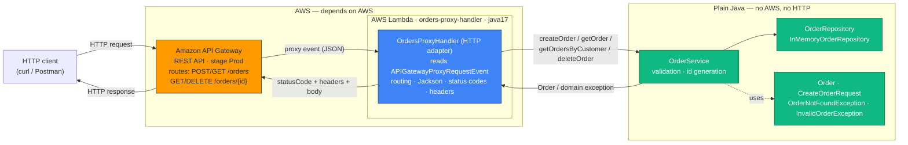
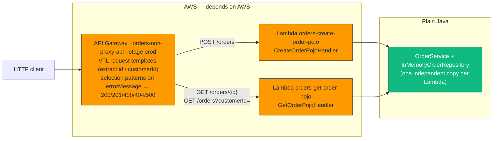

# Designing a Serverless REST API with AWS Lambda and Amazon API Gateway

Implementation, architectural analysis and engineering evaluation of a small **Order Management API** built with Java 17, Maven, JUnit 5, AWS Lambda and Amazon API Gateway.

Two integration styles are deployed side by side and compared:

* **Architecture A — API Gateway non-proxy (custom) integration:** API Gateway extracts parameters with mapping templates and chooses HTTP status codes.
* **Architecture B — Lambda proxy integration:** API Gateway forwards the whole HTTP request and a thin Java HTTP adapter decides the HTTP response.

All results shown in this README are **real outputs** captured on **2026-10-26** in an **AWS Academy Learner Lab** account (`us-east-1`). The raw console transcript and the Lambda logs are stored in [`evidence/`](evidence/).

---

## Table of Contents
1. [API Design & Contract](#1-api-design--contract)
2. [Architecture Diagrams](#2-architecture-diagrams)
3. [Part I — Plain Java Application & Local Tests](#3-part-i--plain-java-application--local-tests)
4. [Part II — Direct Lambda Invocation & JSON Serialization](#4-part-ii--direct-lambda-invocation--json-serialization)
5. [Part III & IV — Architecture A: Non-Proxy Integration](#5-part-iii--iv--architecture-a-non-proxy-integration)
6. [Part V — Architecture B: Lambda Proxy Integration](#6-part-v--architecture-b-lambda-proxy-integration)
7. [In-Memory Storage Is Ephemeral](#7-in-memory-storage-is-ephemeral)
8. [Unexpected Internal Errors (500)](#8-unexpected-internal-errors-500)
9. [Comparison of the Two Architectures](#9-comparison-of-the-two-architectures)
10. [Criticizing the AI Assistant](#10-criticizing-the-ai-assistant)
11. [Final Challenge — DELETE /orders/{id}](#11-final-challenge--delete-ordersid)
12. [Build, Test and Deploy (AWS Academy)](#12-build-test-and-deploy-aws-academy)
13. [Project Structure](#13-project-structure)
14. [Demonstration Video](#14-demonstration-video)

---

## 1. API Design & Contract

### Design questions

**What are the resources in the API?**
The only resource is the **order**. `/orders` is the collection and `/orders/{id}` is one specific order.

**Why `/orders/{id}` to retrieve a particular order?**
A path segment identifies a resource. An order is an element of the `/orders` collection and its identifier uniquely names it, so `GET /orders/ORD-001` addresses exactly one order.

**Why is `customerId` a query parameter?**
Searching by customer does not identify one resource: it **filters the collection**. The target is still `/orders`, and `?customerId=CUST-42` narrows it. A customer is also not modeled as a resource of this API.

**What should `POST /orders` return on success?**
`201 Created`, the created order (including its generated `id`) in the body and a `Location: /orders/{id}` header pointing to the new resource.

**What should the API return when an order does not exist?**
`404 Not Found` with the standard error body (`ORDER_NOT_FOUND`).

**What should an error response contain?**
A stable, machine-readable `error` code and a human-readable `message`. It must **not** contain stack traces or Java class names.

### Contract

| Operation | Method & URL | Input | Success | Errors |
| :--- | :--- | :--- | :--- | :--- |
| Create order | `POST /orders` | Body `{"customerId","product","quantity"}` | `201` + `Order` + `Location` | `400` invalid input / malformed JSON |
| Get order | `GET /orders/{id}` | Path `id` | `200` + `Order` | `404` not found |
| Find by customer | `GET /orders?customerId=` | Query `customerId` | `200` + `Order[]` (may be `[]`) | `400` missing `customerId` |
| Delete order | `DELETE /orders/{id}` | Path `id` | `204`, empty body | `404` not found |
| Any operation | — | — | — | `500` unexpected error |

### Error format

```json
{ "error": "ORDER_NOT_FOUND", "message": "Order ORD-999 does not exist" }
```

| `error` code | HTTP | When |
| :--- | :--- | :--- |
| `INVALID_INPUT` | 400 | Business validation failed (`customerId is required`, `quantity must be greater than 0`, ...) |
| `BAD_REQUEST` | 400 | Body is not valid JSON or a field has the wrong type |
| `ORDER_NOT_FOUND` | 404 | The order id does not exist |
| `ROUTE_NOT_FOUND` | 404 | Unknown path (adapter level) |
| `METHOD_NOT_ALLOWED` | 405 | Known path, unsupported method (adapter level — see [6.4](#64-findings-from-the-deployed-api)) |
| `INTERNAL_SERVER_ERROR` | 500 | Any unexpected failure; no internal details are exposed |

---

## 2. Architecture Diagrams

### Final architecture (Architecture B, proxy integration)



### Architecture A (non-proxy integration), deployed for comparison



### Which components depend on AWS

| Component | Package | AWS? | HTTP? | Role |
| :--- | :--- | :--- | :--- | :--- |
| `Order`, `CreateOrderRequest` | `domain` | No | No | Domain model / input DTO |
| `OrderNotFoundException`, `InvalidOrderException` | `domain` | No | No | Domain outcomes |
| `OrderRepository`, `InMemoryOrderRepository` | `repository` | No | No | Storage abstraction (in memory) |
| `OrderService` | `service` | No | No | Business logic and validation |
| `CreateOrderPojoHandler`, `GetOrderPojoHandler`, `GetOrderRequest` | `lambda.pojo` | Yes (`aws-lambda-java-core`) | No | Lambda entry points for Architecture A |
| `OrdersProxyHandler` | `lambda.proxy` | Yes (`aws-lambda-java-events`) | Yes | HTTP adapter for Architecture B |
| `ErrorResponse` | `lambda.proxy` | No | Yes | HTTP error body (part of the HTTP contract, not of the domain) |

---

## 3. Part I — Plain Java Application & Local Tests

The application logic is ordinary Java: `OrderService` validates input, generates ids (`ORD-` + 6 hex characters) and works with `OrderRepository`. `InMemoryOrderRepository` keeps orders in a `ConcurrentHashMap` and is pre-loaded with `ORD-001` (CUST-42), `ORD-042` (CUST-7) and `ORD-100` (CUST-42).

Real result of `mvn clean test` (Windows, Maven 3.9.6, JDK 21 compiling for Java 17):

```
Tests run: 5,  Failures: 0, Errors: 0, Skipped: 0 -- in com.serverless.workshop.lambda.pojo.PojoHandlersTest
Tests run: 15, Failures: 0, Errors: 0, Skipped: 0 -- in com.serverless.workshop.lambda.proxy.OrdersProxyHandlerTest
Tests run: 8,  Failures: 0, Errors: 0, Skipped: 0 -- in com.serverless.workshop.service.OrderServiceTest
Tests run: 28, Failures: 0, Errors: 0, Skipped: 0
BUILD SUCCESS
```

| Test class | What it covers |
| :--- | :--- |
| `OrderServiceTest` (8) | valid creation, retrieval, non-existent order, search by customer, invalid input, delete existing / non-existent |
| `PojoHandlersTest` (5) | POJO handlers of Architecture A called as plain Java |
| `OrdersProxyHandlerTest` (15) | every HTTP outcome of the adapter: 200, 201 + `Location`, 204, 400 (validation, malformed JSON, wrong type), 404, 405, unknown route, unknown JSON fields, 500 |

### Checkpoint 1

* **Can the functionality be tested without AWS?** Yes. All 28 tests run with `mvn test` and no AWS account, emulator or network.
* **Does the application require a web server?** No. Nothing opens a port; in AWS the Lambda service invokes a Java method.
* **Does it require Spring Boot?** No. Only the AWS Lambda interfaces and Jackson are used.
* **What does the generated JAR contain?** `mvn package` produces two files:
  * `original-orders-api-1.0.0.jar` — **20,653 bytes**, only our compiled classes.
  * `orders-api-1.0.0.jar` — **3,384,988 bytes**, the shaded ("uber") JAR deployed to Lambda: our classes plus `aws-lambda-java-core 1.2.3`, `aws-lambda-java-events 3.11.4`, `joda-time 2.10.8` (pulled by the events library) and Jackson `2.16.1` (`databind`, `core`, `annotations`). JUnit is `test` scope and is not included.
* **Which parts know about HTTP?** Only `lambda.proxy` (`OrdersProxyHandler`, `ErrorResponse`). The domain, repository and service do not.

---

## 4. Part II — Direct Lambda Invocation & JSON Serialization

`CreateOrderPojoHandler implements RequestHandler<CreateOrderRequest, Order>` is deployed unchanged as `orders-create-order-pojo` and invoked with a JSON document:

```powershell
aws lambda invoke --function-name orders-create-order-pojo --cli-binary-format raw-in-base64-out `
  --payload fileb://events/pojo-create-order-input1.json out1.json
```

| Input file | Real output |
| :--- | :--- |
| `pojo-create-order-input1.json` `{"customerId":"CUST-42","product":"MacBook Air","quantity":1}` | `{"id":"ORD-384ABA","customerId":"CUST-42","product":"MacBook Air","quantity":1}` |
| `pojo-create-order-input2.json` `{"customerId":"CUST-99","product":"Dell UltraSharp Monitor","quantity":2}` | `{"id":"ORD-C0904A","customerId":"CUST-99","product":"Dell UltraSharp Monitor","quantity":2}` |

### How does the runtime convert JSON to Java and back?

The Lambda Java runtime reads the handler's generic types (`RequestHandler<CreateOrderRequest, Order>`), creates the input object with its **no-argument constructor** and fills it through the **setters** that match the JSON field names, using a Jackson-based serializer bundled in the runtime. The returned object is serialized back to JSON through its **getters**. If the handler throws, the runtime returns an error document instead.

This explanation was obtained with the help of the AI assistant and then **verified against the deployed function** with four extra inputs:

| Experiment | Input | Real output | Conclusion |
| :--- | :--- | :--- | :--- |
| Unknown field | `{"customerId":"CUST-1","product":"Mouse","quantity":1,"extra":true}` | `{"id":"ORD-41B09B",...,"quantity":1}` | Unknown fields are **ignored** |
| Number as text | `..."quantity":"2"}` | `{"id":"ORD-449E09",...,"quantity":2}` | The string `"2"` is **coerced** to `int` |
| Missing field | `{"customerId":"CUST-1","product":"Mouse"}` | `{"errorMessage":"quantity must be greater than 0",...}` | A missing `int` keeps its Java default **0**, so our validation rejects it |
| Exception | `{"customerId":"","product":"Mouse","quantity":1}` | `{"errorMessage":"customerId is required","errorType":"com.serverless.workshop.domain.InvalidOrderException","stackTrace":["com.serverless.workshop.service.OrderService.createOrder(OrderService.java:36)", ...]}` | An uncaught exception becomes `errorMessage` + `errorType` + **full stack trace** |

The last row matters for the architecture: when a Lambda is called directly, an exception exposes internal class names and line numbers. Architecture A hides it with response templates and Architecture B never lets the exception leave the adapter.

### Checkpoint 2 — actual flow

```
{"customerId":"CUST-42","product":"MacBook Air","quantity":1}      (JSON payload)
        │
        ▼
AWS Lambda Java runtime ── new CreateOrderRequest() + setters      (JSON → Java object)
        │
        ▼
CreateOrderPojoHandler.handleRequest(request, context)
        │  orderService.createOrder(request)
        ▼
Order("ORD-384ABA","CUST-42","MacBook Air",1)                      (Java object)
        │
        ▼
AWS Lambda Java runtime ── getters                                 (Java object → JSON)
        │
        ▼
{"id":"ORD-384ABA","customerId":"CUST-42","product":"MacBook Air","quantity":1}
```

---

## 5. Part III & IV — Architecture A: Non-Proxy Integration

Defined in [`orders-api/template.yaml`](orders-api/template.yaml) as the `NonProxyOrdersApi` resource (Swagger 2.0 with `x-amazon-apigateway-integration` of type `aws`). The reference copies of the request templates are in [`orders-api/api-gateway/vtl/`](orders-api/api-gateway/vtl/).

### Request mapping (API Gateway builds the JSON the Java function expects)

| Route | Lambda | Request template |
| :--- | :--- | :--- |
| `GET /orders/{id}` | `orders-get-order-pojo` | `{ "id": "$util.escapeJavaScript($input.params('id'))" }` |
| `GET /orders?customerId=` | `orders-get-order-pojo` | `{ "customerId": "$util.escapeJavaScript($input.params('customerId'))" }` |
| `POST /orders` | `orders-create-order-pojo` | `$input.json('$')` |

So for `GET /orders/ORD-001` the Java handler only receives `{"id":"ORD-001"}` and never sees the HTTP request.

### Response mapping (API Gateway chooses the status code)

API Gateway matches the Lambda `errorMessage` against regular expressions:

| Selection pattern | Status | Body (response template) |
| :--- | :--- | :--- |
| *(no error)* | `200` (`201` for POST) | Lambda result unchanged |
| `(?s).*does not exist.*` | `404` | `{ "error": "ORDER_NOT_FOUND", "message": <errorMessage> }` |
| `(?s).*(required\|must\|cannot\|JSON parsing).*` | `400` | `{ "error": "INVALID_INPUT", "message": <errorMessage> }` |
| `(?s)(?!.*(does not exist\|required\|must\|cannot\|JSON parsing)).+` | `500` | `{ "error": "INTERNAL_SERVER_ERROR", "message": "An unexpected internal error occurred" }` |

### Real results (`https://<api-id>.execute-api.us-east-1.amazonaws.com/prod/orders`)

| # | Request | Status | Body |
| :--- | :--- | :--- | :--- |
| A1 | `POST /orders` (CUST-42, MacBook Air, 1) | **201 Created** | `{"id":"ORD-63518C","customerId":"CUST-42","product":"MacBook Air","quantity":1}` |
| A2 | `GET /orders/ORD-001` | **200 OK** | `{"id":"ORD-001","customerId":"CUST-42","product":"MacBook Air","quantity":1}` |
| A3 | `GET /orders?customerId=CUST-42` | **200 OK** | `[ORD-001, ORD-100]` — the order created in A1 is **not** listed |
| A4 | `GET /orders?customerId=CUST-100` | **200 OK** | `[]` |
| A5 | `GET /orders/ORD-999` | **404 Not Found** | `{ "error": "ORDER_NOT_FOUND", "message": "Order ORD-999 does not exist" }` |
| A6 | `POST /orders` `{"customerId":"","product":"Mouse","quantity":0}` | **400 Bad Request** | `{ "error": "INVALID_INPUT", "message": "customerId is required" }` |
| A7 | `GET /orders` (no `customerId`) | **400 Bad Request** | `{ "error": "INVALID_INPUT", "message": "Either id or customerId must be provided" }` |

Observations:
* **No `Location` header in A1.** A mapping template cannot easily build `/orders/{id}` from the Lambda result.
* **A3 does not contain `ORD-63518C`.** POST and GET are different Lambdas with separate memory (see [section 7](#7-in-memory-storage-is-ephemeral)).
* The error JSON is produced by VTL, not by Jackson (note the spaces), so the format has to be kept consistent by hand.

### Checkpoint 3 — what API Gateway is responsible for in Architecture A

* **Routing:** each method/path is wired to a specific Lambda.
* **Extracting path and query parameters:** `$input.params('id')`, `$input.params('customerId')`.
* **Transforming requests:** building the JSON document for the POJO handler.
* **Choosing status codes:** 201 for POST, 404/400/500 from regular expressions over `errorMessage`.
* **Transforming responses and mapping errors:** response templates build the `{error, message}` body and hide the stack trace.

**Advantages:** the Java handlers are plain POJOs with no HTTP knowledge; the stack trace is hidden at the edge; one place (API Gateway) defines the whole HTTP contract.

**Disadvantages:**
* The **status code depends on the text of Java exception messages.** Renaming `"customerId is required"` would silently change a 400 into a 500 and no unit test would detect it.
* The mapping logic (VTL + regex) **cannot be tested locally** — it was only verified after deploying.
* The configuration is large: the non-proxy API plus its permissions take about **140 lines** of `template.yaml` for 3 operations.
* Some HTTP features are awkward, e.g. the `Location` header.

---

## 6. Part V — Architecture B: Lambda Proxy Integration

### 6.1 The proxy event

API Gateway sends the whole request to `orders-proxy-handler`. Two **real events** captured from CloudWatch Logs are saved in the repository (IP address and account id replaced):

* [`orders-api/events/real-proxy-event-post-order.json`](orders-api/events/real-proxy-event-post-order.json)
* [`orders-api/events/real-proxy-event-get-orders-by-customer.json`](orders-api/events/real-proxy-event-get-orders-by-customer.json)

| Information | Where it appears in the event | Example from the real events |
| :--- | :--- | :--- |
| HTTP method | `httpMethod` (also `requestContext.httpMethod`) | `"POST"` |
| Path | `path`; the matched template is in `resource`; `requestContext.path` includes the stage | `"/orders"`, `"resource": "/orders/{id}"`, `"/Prod/orders"` |
| Path parameters | `pathParameters` | `{"id": "ORD-001"}` (`null` for `/orders`) |
| Query parameters | `queryStringParameters` (and `multiValueQueryStringParameters`) | `{"customerId": "CUST-42"}` |
| Headers | `headers` (and `multiValueHeaders`) | `Content-Type`, `User-Agent`, `Host`, `CloudFront-*` |
| Body | `body` — **always a string**, not a JSON object | `"{\r\n  \"customerId\": \"CUST-42\", ...}"` |

Because `body` is a string, the adapter must deserialize it itself with Jackson.

### 6.2 The HTTP adapter

[`OrdersProxyHandler`](orders-api/src/main/java/com/serverless/workshop/lambda/proxy/OrdersProxyHandler.java) is the only class that knows about API Gateway events and HTTP:

* Routes `/orders` (GET, POST) and `/orders/{id}` (GET, DELETE); a known path with another method returns `405` + `Allow`, an unknown path `404`.
* Reads `pathParameters`, `queryStringParameters` and `body`; deserializes the body with Jackson, **ignoring unknown fields** (the same behavior observed in the Lambda runtime in section 4).
* Maps domain outcomes to HTTP: `OrderNotFoundException` → 404, `InvalidOrderException` → 400, malformed JSON / wrong type → 400 with a clean message (e.g. `Invalid value for field 'quantity'`), anything else → 500.
* Builds the response: status code, `Content-Type` only when there is a body, `Location` after creation.
* Logs the full incoming event so a real example can be copied from CloudWatch.

`OrderService` still only deals with orders, customers, products and quantities.

### 6.3 Real results (`https://<api-id>.execute-api.us-east-1.amazonaws.com/Prod/orders`)

| # | Request | Status | Relevant headers / body |
| :--- | :--- | :--- | :--- |
| B1 | `POST /orders` (CUST-42, MacBook Air, 1) | **201 Created** | `Location: /orders/ORD-18548F` · `{"id":"ORD-18548F",...}` |
| B2 | `GET /orders/ORD-001` | **200 OK** | `{"id":"ORD-001","customerId":"CUST-42","product":"MacBook Air","quantity":1}` |
| B3 | `GET /orders?customerId=CUST-42` | **200 OK** | `[ORD-001, ORD-100, ORD-18548F]` — includes the order created in B1 |
| B4 | `GET /orders?customerId=CUST-100` | **200 OK** | `[]` |
| B5 | `GET /orders/ORD-999` | **404 Not Found** | `{"error":"ORDER_NOT_FOUND","message":"Order ORD-999 does not exist"}` |
| B6 | `POST /orders` `{"customerId":"","product":"Mouse","quantity":0}` | **400 Bad Request** | `{"error":"INVALID_INPUT","message":"customerId is required"}` |
| B7 | `DELETE /orders/ORD-042` | **204 No Content** | empty body |
| B8 | `DELETE /orders/ORD-999` | **404 Not Found** | `{"error":"ORDER_NOT_FOUND","message":"Order ORD-999 does not exist"}` |
| B9 | `PUT /orders` | **403 Forbidden** | `{"message":"Missing Authentication Token"}` (see below) |

### 6.4 Findings from the deployed API

* **The 405 of the adapter is never reached through API Gateway.** `template.yaml` declares each route explicitly, so API Gateway rejects `PUT /orders` with `403 Missing Authentication Token` before invoking the Lambda. The 405 logic is only exercised by the unit tests. With explicit routes, **routing is effectively an API Gateway responsibility even in the proxy architecture**; a greedy `{proxy+}` route would move it into Java.
* **API Gateway adds `Content-Type: application/json` to the 204 response**, even though the adapter does not send it (verified by `testDeleteOrderHasNoContentType`). A REST API proxy integration adds this default header when the Lambda omits it.
* **Cold start (real measurement from CloudWatch `REPORT` lines):** first request `Init Duration: 786.76 ms` + `Duration: 772.84 ms`; the following seven requests took between **2.41 ms and 32.07 ms**, using 110 MB of the 512 MB configured.

---

## 7. In-Memory Storage Is Ephemeral

Orders are stored in a `ConcurrentHashMap` inside each Lambda execution environment. This is **not** persistent storage:

* **Each Lambda function has its own memory.** `ORD-384ABA` was created by invoking `orders-create-order-pojo`; asking `orders-get-order-pojo` for it returned `{"errorMessage":"Order ORD-384ABA does not exist", ...}`, while `ORD-001` (pre-loaded in every environment) was found. The same effect explains A3.
* **One function shares memory only while its environment is alive.** In Architecture B all routes run in `orders-proxy-handler`, so B3 found the order created in B1 — but only because the same warm environment served both requests.
* When Lambda creates a new environment (cold start, scaling to several concurrent environments, or after a period of inactivity) the data goes back to the three seeded orders.

A real system would replace `InMemoryOrderRepository` with an implementation backed by a database (for example DynamoDB). Because `OrderService` depends on the `OrderRepository` interface, only that class and its wiring would change.

---

## 8. Unexpected Internal Errors (500)

| Situation | What the client gets |
| :--- | :--- |
| Architecture B | The adapter's last `catch (Exception)` logs the error and returns `500 {"error":"INTERNAL_SERVER_ERROR","message":"An unexpected internal error occurred"}`. Verified locally by `testUnexpectedErrorReturns500` (a service that throws `IllegalStateException`). |
| Architecture A | Any `errorMessage` that matches none of the known patterns is mapped by API Gateway to the same 500 body. |
| Direct Lambda invocation | The runtime returns `errorMessage`, `errorType` and the full `stackTrace` (section 4). |

---

## 9. Comparison of the Two Architectures

| Question | Architecture A — API Gateway transformation | Architecture B — proxy + Java adapter |
| :--- | :--- | :--- |
| **More API Gateway configuration?** | **A.** ~140 lines of `template.yaml`: request templates, selection patterns, response templates and explicit Lambda permissions for 3 operations. | ~33 lines: one function with four `Api` events; SAM generates integrations and permissions. |
| **More Java infrastructure code?** | Small POJO handlers (`CreateOrderPojoHandler`, `GetOrderPojoHandler`, `GetOrderRequest`: ~120 lines). | **B.** `OrdersProxyHandler` (~200 lines) + `ErrorResponse`. |
| **Easier to test locally?** | Only the POJO handlers. Parameter extraction and status codes were verified only after deploying. | **B.** 15 unit tests cover routing, status codes, headers and error bodies without AWS. |
| **Where are status codes defined?** | In API Gateway integration responses, by regex over exception messages. | In Java, in `OrdersProxyHandler`. |
| **From 3 to 30 operations?** | 30 sets of templates and regexes, each coupled to exception texts; changes need a redeploy to be checked. | 30 explicit routes in `template.yaml` (or one `{proxy+}`) and more routing code; at that size the adapter should use a small router or be split by resource. |
| **Cleaner Java business logic?** | Both keep `OrderService` free of HTTP. In A, HTTP knowledge leaks into the *text* of exception messages. | Both keep `OrderService` free of HTTP. The adapter isolates all HTTP concerns. |
| **Easier for another developer to understand?** | Harder: behavior is split between Java and VTL/regex in the template. | Easier: the HTTP behavior is readable and testable Java. |
| **Choice for a larger system** | — | **B**, because the HTTP contract is version-controlled, unit-tested and not coupled to exception messages. Keeping API Gateway for cross-cutting concerns (auth, throttling, request validation) is still useful. |

---

## 10. Criticizing the AI Assistant

> Review note for the author: these entries must reflect your own judgment. Edit them so they describe what you actually saw and decided.

### Decision 1 — One Lambda for the whole Orders API (proxy) vs one Lambda per operation
* **Decision made by the agent:** a single `OrdersProxyHandler` routing every method, while keeping two POJO Lambdas only for Architecture A.
* **Why it probably proposed it:** fewer functions to deploy, one place for serialization and error mapping, fewer cold starts.
* **Do I agree?** Mostly. The measured cold start (~0.8 s init + ~0.8 s first request, then 2–32 ms) shows that sharing one warm environment helps. But one Lambda gets the permissions of all operations, and the deployed test showed routing still lives in API Gateway with explicit routes.
* **Alternative:** one Lambda per operation (least privilege, independent memory and scaling), or one Lambda per resource.
* **What I implemented and why:** one proxy Lambda for Architecture B (cohesive, small API) and separate POJO Lambdas for Architecture A to compare both models.

### Decision 2 — Location of validation
* **Decision made by the agent:** all business validation in `OrderService`, throwing `InvalidOrderException`.
* **Why:** the domain protects its own rules regardless of the entry point (POJO handler, proxy adapter or tests).
* **Do I agree?** Yes, with one addition: JSON syntax and type errors belong to the adapter (`BAD_REQUEST`). The experiments in section 4 showed a subtle gap: a missing `quantity` becomes `0` and is reported as `quantity must be greater than 0` instead of "quantity is required".
* **Alternative:** API Gateway request validation with a JSON Schema model, rejecting bad requests before invoking Lambda (cheaper, but duplicates the rules).
* **What I implemented and why:** validation in the service, syntax errors in the adapter. It is portable and testable without AWS.

### Decision 3 — Error handling and status codes in Architecture A
* **Decision made by the agent:** derive HTTP status codes from the Lambda `errorMessage` with regular expressions.
* **Why:** it is the standard mechanism of non-proxy integrations; the POJO handlers can stay HTTP-free.
* **Do I agree?** It works (A5, A6 and A7 returned 404/400 as expected), but it couples the HTTP contract to human-readable messages that nobody would expect to be part of an API.
* **Alternative:** prefix messages with stable codes (e.g. `NOT_FOUND:`), or use Architecture B where status codes depend on exception **types**.
* **What I implemented and why:** the regex mapping, documented as the main weakness of Architecture A and one of the reasons to prefer B.

### Additional observation — an assumption the agent got wrong
When asked about the DELETE extension, the agent first stated that **no API Gateway change was needed** (assuming a greedy `{proxy+}` route). In this project the SAM template declares each route, so a new `DELETE /orders/{id}` event **was** required. Likewise, the 405 handling it proposed is unreachable in the deployed API (section 6.4). Both cases show that the agent's architectural claims must be checked against the actual configuration.

---

## 11. Final Challenge — DELETE /orders/{id}

### Pre-Implementation Prediction
The prediction was written and committed **before** implementing the operation, in its own commit (`docs: prediction for DELETE /orders/{id}`), followed by the implementation commit (`feat: implement DELETE /orders/{id}`). See [`orders-api/PREDICTION.md`](orders-api/PREDICTION.md).

| Question | Prediction |
| :--- | :--- |
| Which Java classes should change? | `OrderRepository`, `InMemoryOrderRepository`, `OrderService`, `OrdersProxyHandler`. `Order` and `CreateOrderRequest` should not change. |
| New Lambda function? | Not in Architecture B (the proxy handler routes by method). Yes in Architecture A (one POJO handler per operation). |
| API Gateway changes? | Yes: `template.yaml` declares every route explicitly, so a `DELETE /orders/{id}` event must be added. |
| Where does deletion logic live? | Application logic (`OrderService` + `OrderRepository`). |
| Where is 204 vs 404 decided? | `OrderService` decides whether the order existed (throws `OrderNotFoundException`); `OrdersProxyHandler` maps success → 204 and the exception → 404. |
| Tests to add | 2 in `OrderServiceTest`, 2 in `OrdersProxyHandlerTest`. |

### Evaluation & Comparison

| Aspect | Prediction | Agent implementation | Match? |
| :--- | :--- | :--- | :--- |
| Classes changed | 4 classes, domain entities untouched | Same 4 classes; `Order` / `CreateOrderRequest` untouched | Yes |
| New Lambda | None for Architecture B | None; a new `DELETE` case in `OrdersProxyHandler` | Yes |
| Architecture A | Would need a new POJO handler + mappings | Not implemented: DELETE exists only in Architecture B | Partial — the agent skipped it |
| API Gateway | New route in `template.yaml` | Added `DeleteOrderById` event (`DELETE /orders/{id}`) | Yes |
| 204 / 404 decision | Service signals existence, adapter picks status | `deleteOrder` throws `OrderNotFoundException`; the adapter returns 404, success returns 204 | Yes |
| Tests | 4 new tests | 4 new tests (2 service, 2 adapter) | Yes |
| Extra | — | Added an example proxy event `events/apigw-proxy-delete-order.json` | Not predicted |

**Observations:**
* The prediction was correct because responsibilities were already separated: the change touched the repository, the service and one case in the adapter, and no domain entity.
* The agent's earlier claim that no API Gateway change was needed was wrong for this project (see section 10).
* The first implementation also sent `Content-Type` on the 204; it was removed later in the adapter, but API Gateway still adds it (section 6.4).

**Verification on the deployed API:** `DELETE /orders/ORD-042` → **204 No Content** (B7); `DELETE /orders/ORD-999` → **404** `ORDER_NOT_FOUND` (B8).

---

## 12. Build, Test and Deploy (AWS Academy)

Requirements: JDK 17+ (tested with JDK 21 targeting 17), Maven 3.9, AWS CLI v2, AWS SAM CLI.

### Build and test locally
```powershell
cd orders-api
mvn clean test      # 28 tests
mvn package         # target/orders-api-1.0.0.jar (shaded)
```

### AWS Academy Learner Lab credentials
1. Start the lab and open **AWS Details → AWS CLI → Show**.
2. Copy the `[default]` block (including `aws_session_token`) to `%USERPROFILE%\.aws\credentials` (no `.txt` extension).
3. Set the region: `%USERPROFILE%\.aws\config` → `[default]` / `region = us-east-1`.
4. Check with `aws sts get-caller-identity` (the ARN contains `voclabs`). Credentials expire with the lab session.

The Learner Lab **cannot create IAM roles**, so every function uses the existing `LabRole` (parameter `LabRoleName`).

### Deploy
```powershell
sam deploy --guided
```
Answers used: stack `orders-api`, region `us-east-1`, `LabRoleName` = `LabRole`, confirm changes `y`, **allow SAM CLI IAM role creation `n`**, `y` to "no authentication" warnings, save configuration `y`.

Outputs: `ProxyApiEndpoint` (Architecture B, stage `Prod`), `NonProxyApiEndpoint` (Architecture A, stage `prod`) and the three function names (`orders-proxy-handler`, `orders-create-order-pojo`, `orders-get-order-pojo`).

### Example calls (PowerShell — use `curl.exe`, not the `curl` alias)
```powershell
$B = "<ProxyApiEndpoint>"
curl.exe -i -X POST $B -H "Content-Type: application/json" --data-binary "@events/pojo-create-order-input1.json"
curl.exe -i "$B/ORD-001"
curl.exe -i "$B`?customerId=CUST-42"
curl.exe -i "$B/ORD-999"
curl.exe -i -X DELETE "$B/ORD-042"
```

### Remove the stack
```powershell
sam delete --stack-name orders-api
```

---

## 13. Project Structure

```
├── README.md
├── evidence/
│   ├── aws-session-2026-10-26.txt        # PowerShell transcript: tests, package, deploy, invocations, curl calls
│   └── proxy-lambda-logs-2026-10-26.txt  # CloudWatch logs of orders-proxy-handler
└── orders-api/
    ├── pom.xml
    ├── template.yaml                     # SAM: Architecture B (proxy) + Architecture A (non-proxy)
    ├── PREDICTION.md                     # DELETE prediction (committed before implementing)
    ├── api-gateway/vtl/                  # reference copies of the request mapping templates
    ├── events/
    │   ├── pojo-*.json                   # inputs for direct Lambda invocation
    │   ├── apigw-proxy-*.json            # hand-written proxy events
    │   └── real-proxy-event-*.json       # real proxy events from CloudWatch
    └── src/
        ├── main/java/com/serverless/workshop/
        │   ├── domain/        Order, CreateOrderRequest, OrderNotFoundException, InvalidOrderException
        │   ├── repository/    OrderRepository, InMemoryOrderRepository
        │   ├── service/       OrderService
        │   └── lambda/
        │       ├── pojo/      CreateOrderPojoHandler, GetOrderPojoHandler, GetOrderRequest   (Architecture A)
        │       └── proxy/     OrdersProxyHandler, ErrorResponse                              (Architecture B)
        └── test/java/com/serverless/workshop/
            ├── service/OrderServiceTest.java
            └── lambda/{pojo/PojoHandlersTest.java, proxy/OrdersProxyHandlerTest.java}
```

---

## 14. Demonstration Video

**Video:** _TODO — add link_

Contents: `mvn test`, `mvn package`, direct `aws lambda invoke`, successful POST and GET, a 404 and a 400 response, the DELETE extension (204 / 404) and the architecture diagram.
