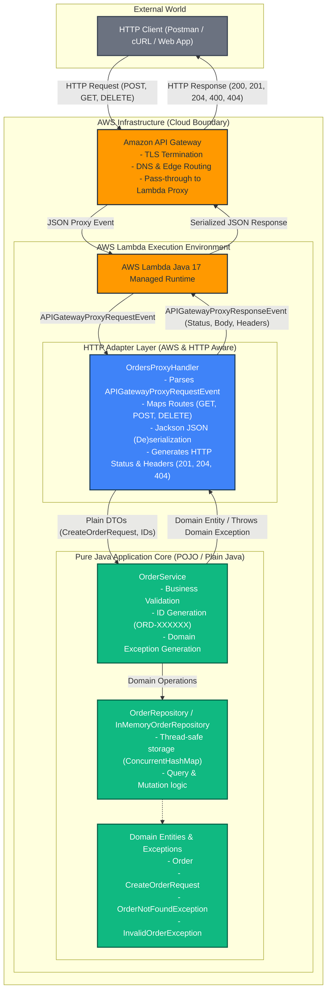

# Designing a Serverless REST API with AWS Lambda and Amazon API Gateway

This repository contains the complete implementation, architectural analysis, and engineering evaluation for the **Order Management Serverless REST API** built with Java 17, AWS Lambda, Amazon API Gateway, and Maven.

---

## Table of Contents
1. [Project Overview & Learning Objectives](#1-project-overview--learning-objectives)
2. [API Design & Contract Specification](#2-api-design--contract-specification)
   - [API Design Questions & Justifications](#api-design-questions--justifications)
   - [HTTP Endpoints & Contract Table](#http-endpoints--contract-table)
   - [Standard Error Format](#standard-error-format)
3. [Architecture Overview & System Diagrams](#3-architecture-overview--system-diagrams)
   - [Final Architecture Diagram](#final-architecture-diagram)
   - [AWS Dependencies vs Pure Java Separation](#aws-dependencies-vs-pure-java-separation)
4. [Part I — Plain Java Implementation & Local Testing](#4-part-i--plain-java-implementation--local-testing)
   - [Domain & Service Design](#domain--service-design)
   - [Checkpoint 1: Local Testing Without AWS](#checkpoint-1-local-testing-without-aws)
5. [Part II — AWS Lambda Direct Invocation & JSON Serialization](#5-part-ii--aws-lambda-direct-invocation--json-serialization)
   - [Runtime Deserialization Investigation](#runtime-deserialization-investigation)
   - [Checkpoint 2: Serialization Flow Diagram](#checkpoint-2-serialization-flow-diagram)
6. [Part III & IV — Architecture A: API Gateway Non-Proxy Integration](#6-part-iii--iv--architecture-a-api-gateway-non-proxy-integration)
   - [VTL Mapping Templates](#vtl-mapping-templates)
   - [Checkpoint 3: Responsibility Distribution Analysis](#checkpoint-3-responsibility-distribution-analysis)
7. [Part V — Architecture B: Lambda Proxy Integration](#7-part-v--architecture-b-lambda-proxy-integration)
   - [Proxy Event Structure](#proxy-event-structure)
   - [HTTP Adapter Implementation](#http-adapter-implementation)
   - [HTTP Semantics & Status Codes](#http-semantics--status-codes)
8. [Comprehensive Architecture Comparison (A vs B)](#8-comprehensive-architecture-comparison-a-vs-b)
9. [Criticize Your AI Assistant (3 Critical Decisions)](#9-criticize-your-ai-assistant-3-critical-decisions)
10. [Final Challenge — DELETE /orders/{id}](#10-final-challenge--delete-ordersid)
    - [Pre-Implementation Prediction](#pre-implementation-prediction)
    - [Evaluation & Comparison](#evaluation--comparison)
11. [Project Structure](#11-project-structure)
12. [Step-by-Step Build, Test, and Demonstration Guide](#12-step-by-step-build-test-and-demonstration-guide)

---

## 1. Project Overview & Learning Objectives

The primary goal of this project is to explore how architectural responsibilities are partitioned between **Amazon API Gateway**, **AWS Lambda**, and a **clean Java application core**.

### Core Competencies Demonstrated
* **Decoupled Java Core**: Writing business logic that has zero compile-time dependencies on AWS, HTTP, or web containers.
* **Dual Integration Patterns**: Implementing and contrasting **Non-Proxy Integration (Architecture A)** with **Lambda Proxy Integration (Architecture B)**.
* **Strict HTTP Semantics**: Implementing proper RESTful status codes (`200 OK`, `201 Created` with `Location` header, `204 No Content`, `400 Bad Request`, `404 Not Found`, `500 Internal Server Error`).
* **Engineering Evaluation**: Critically analyzing AI architectural suggestions instead of passively accepting defaults.

---

## 2. API Design & Contract Specification

### API Design Questions & Justifications

#### 1. What are the resources in your API?
The primary resource is **`orders`** (representing order business entities).
* `/orders`: The collection resource representing all orders.
* `/orders/{id}`: The individual order resource representing a single specific order by its unique identifier.

#### 2. Why did you choose `/orders/{id}` to retrieve a particular order?
According to REST architectural constraints, path segments identify hierarchical resource containment. An individual order is a member of the `/orders` collection. Using a path parameter `{id}` uniquely identifies that individual resource as a distinct URI endpoint (`GET /orders/ORD-001`), adhering to standard REST addressing conventions.

#### 3. Why is `customerId` represented as a query parameter in the search operation?
In RESTful design:
* Path parameters identify a **specific resource**.
* Query parameters provide **filtering, searching, sorting, or pagination** criteria on a collection.
Because searching orders by customer does not identify a single unique order resource, but rather filters the `/orders` collection to find all matching items, `GET /orders?customerId=CUST-42` correctly preserves `/orders` as the target collection being queried.

#### 4. What should `POST /orders` return when an order is successfully created?
* **HTTP Status Code**: `201 Created`
* **Response Header**: `Location: /orders/{id}` (pointing to the URI of the newly created resource).
* **Response Body**: The complete JSON representation of the created order, including its newly generated unique identifier (`id`).

#### 5. What should the API return when an order does not exist?
* **HTTP Status Code**: `404 Not Found`
* **Response Body**: A structured error payload:
  ```json
  {
    "error": "ORDER_NOT_FOUND",
    "message": "Order ORD-999 does not exist"
  }
  ```

#### 6. What information should an error response contain?
A predictable and machine-readable error payload must include:
1. `error`: A concise, stable, machine-readable error code (e.g., `ORDER_NOT_FOUND`, `INVALID_INPUT`, `BAD_REQUEST`).
2. `message`: A human-readable diagnostic explanation describing what went wrong.

---

### HTTP Endpoints & Contract Table

| Operation | Method | URI | Path Params | Query Params | Request Body | Success Status | Success Body / Headers | Error Status Codes |
| :--- | :--- | :--- | :--- | :--- | :--- | :--- | :--- | :--- |
| **Create Order** | `POST` | `/orders` | None | None | `{"customerId":"CUST-42", "product":"MacBook Air", "quantity":1}` | `201 Created` | `Order` JSON<br>Header: `Location: /orders/{id}` | `400 Bad Request`<br>`500 Internal Error` |
| **Retrieve Order** | `GET` | `/orders/{id}` | `id` (e.g. `ORD-001`) | None | None | `200 OK` | `Order` JSON | `400 Bad Request`<br>`404 Not Found` |
| **Find Orders by Customer** | `GET` | `/orders` | None | `customerId` (e.g. `CUST-42`) | None | `200 OK` | Array of `Order` JSON `[...]` | `400 Bad Request`<br>`500 Internal Error` |
| **Delete Order** | `DELETE` | `/orders/{id}` | `id` (e.g. `ORD-001`) | None | None | `204 No Content` | *Empty Body* | `400 Bad Request`<br>`404 Not Found` |

### Standard Error Format
```json
{
  "error": "ORDER_NOT_FOUND",
  "message": "Order ORD-999 does not exist"
}
```

---

## 3. Architecture Overview & System Diagrams

### Final Architecture Diagram



### AWS Dependencies vs Pure Java Separation

| Component | Package / Module | Depends on AWS? | Depends on HTTP? | Purpose |
| :--- | :--- | :--- | :--- | :--- |
| `Order` | `com.serverless.workshop.domain` | **No** (Pure Java) | **No** | Core domain entity |
| `CreateOrderRequest` | `com.serverless.workshop.domain` | **No** (Pure Java) | **No** | Input DTO for creation |
| `OrderNotFoundException` | `com.serverless.workshop.domain` | **No** (Pure Java) | **No** | Business domain exception |
| `InvalidOrderException` | `com.serverless.workshop.domain` | **No** (Pure Java) | **No** | Business validation exception |
| `OrderRepository` | `com.serverless.workshop.repository` | **No** (Pure Java) | **No** | Persistence abstraction interface |
| `InMemoryOrderRepository`| `com.serverless.workshop.repository` | **No** (Pure Java) | **No** | Thread-safe in-memory store |
| `OrderService` | `com.serverless.workshop.service` | **No** (Pure Java) | **No** | Pure application business logic |
| `OrdersProxyHandler` | `com.serverless.workshop.lambda.proxy` | **Yes** (`aws-lambda-java-events`) | **Yes** (Status codes, headers) | HTTP Adapter / Front Controller |
| `CreateOrderPojoHandler`| `com.serverless.workshop.lambda.pojo` | **Yes** (`aws-lambda-java-core`) | **No** | Direct POJO handler for Arch A |
| `GetOrderPojoHandler` | `com.serverless.workshop.lambda.pojo` | **Yes** (`aws-lambda-java-core`) | **No** | Direct POJO handler for Arch A |

---

## 4. Part I — Plain Java Implementation & Local Testing

### Domain & Service Design
The core business layer is implemented in standard Java 17:
* **Validation**: Performed entirely inside `OrderService.java` (e.g. verifying non-null strings, non-blank customer IDs, quantity $> 0$).
* **Storage**: Encapsulated behind `OrderRepository.java` using a `ConcurrentHashMap` inside `InMemoryOrderRepository.java`.
* **Testing**: 8 JUnit 5 tests verify every business rule without starting any network port, server, or cloud emulator.

### Checkpoint 1: Local Testing Without AWS

#### Can the application functionality be tested without AWS?
**Yes, 100%.** Because `OrderService` and `InMemoryOrderRepository` have zero imports from `com.amazonaws.*`, unit tests run directly in standard JVM test runners within milliseconds (`mvn test`).

#### Does your application require a web server?
**No.** The application does not instantiate Tomcat, Jetty, Netty, or any HTTP listener. When deployed on AWS Lambda, AWS manages the underlying server and execution container. Locally, tests invoke plain Java methods directly.

#### Does it require Spring Boot?
**No.** Avoiding Spring Boot eliminates large JAR sizes (saving dozens of megabytes) and avoids JVM reflection overhead, drastically minimizing Lambda **cold start latency** from ~6–10 seconds down to <1 second.

#### What does the generated JAR contain?
The Maven Shade plugin packages an **Uber-JAR** (`orders-api-1.0.0.jar`, ~3.3 MB) containing:
1. Compiled application `.class` files (`domain`, `repository`, `service`, `lambda`).
2. AWS Lambda core interfaces (`aws-lambda-java-core`, `aws-lambda-java-events`).
3. Jackson databind library and its dependencies for JSON serialization.
4. `META-INF/MANIFEST.MF`.
*(JUnit dependencies are marked `<scope>test</scope>` and are excluded from the runtime JAR).*

#### Which parts of your application currently know about HTTP?
In Part I, **none**. Neither `Order`, `CreateOrderRequest`, `OrderRepository`, nor `OrderService` know about HTTP methods, status codes, query strings, or headers. Only the later adapter classes (`OrdersProxyHandler`) introduce HTTP knowledge.

---

## 5. Part II — AWS Lambda Direct Invocation & JSON Serialization

### Runtime Deserialization Investigation

#### How does the AWS Lambda Java runtime convert JSON input into Java objects and return values back to JSON?
1. **Invocation Entry Point**: When Lambda invokes a handler method such as `handleRequest(CreateOrderRequest input, Context context)`, the Lambda runtime reads the raw incoming UTF-8 byte stream from the AWS Lambda Runtime API endpoint (`/runtime/invocation/next`).
2. **Built-in POJO Deserialization**: The official AWS Lambda Java runtime contains a built-in JSON serializer (implemented internally via Jackson).
   - If the handler parameter is a POJO (e.g. `CreateOrderRequest`), the runtime inspects the class structure via reflection.
   - It instantiates the target class using its default no-argument constructor.
   - It matches JSON field names with corresponding Java setter methods or public fields (e.g., `"customerId"` $\to$ `setCustomerId(String)`).
3. **Return Value Serialization**: When the Java method returns a Java object (e.g., `Order`), the Lambda runtime serializes the object's getter properties into a UTF-8 JSON string and posts it to the Runtime API invocation response endpoint (`/runtime/invocation/{AwsRequestId}/response`).

### Checkpoint 2: Serialization Flow Diagram

```
+-------------------------------------------------------------+
|                     Client / AWS CLI                        |
+-------------------------------------------------------------+
                              |
                              | Raw JSON Payload:
                              | {"customerId":"CUST-42", "product":"MacBook Air", "quantity":1}
                              v
+-------------------------------------------------------------+
|               AWS Lambda Managed Java Runtime               |
|                                                             |
| 1. Reads incoming byte stream from Runtime API              |
| 2. Identifies target parameter type: CreateOrderRequest.class|
| 3. Built-in Jackson Deserializer maps JSON keys to Setters  |
+-------------------------------------------------------------+
                              |
                              | Instantiated Java Object:
                              | CreateOrderRequest instance
                              v
+-------------------------------------------------------------+
|               User Handler Method (Java)                    |
|       CreateOrderPojoHandler::handleRequest                 |
|                                                             |
| - Executes business logic: orderService.createOrder(req)   |
| - Generates ID, validates business constraints              |
| - Returns new Order("ORD-XXXXXX", "CUST-42", ...)           |
+-------------------------------------------------------------+
                              |
                              | Resulting Java Object:
                              | Order instance
                              v
+-------------------------------------------------------------+
|               AWS Lambda Managed Java Runtime               |
|                                                             |
| 1. Intercepts return value                                  |
| 2. Built-in Jackson Serializer reads Getters via Reflection |
| 3. Generates UTF-8 JSON String                              |
+-------------------------------------------------------------+
                              |
                              | Response JSON:
                              | {"id":"ORD-8A3B12","customerId":"CUST-42",...}
                              v
+-------------------------------------------------------------+
|                     Client / Caller                         |
+-------------------------------------------------------------+
```

---

## 6. Part III & IV — Architecture A: API Gateway Non-Proxy Integration

In Architecture A, API Gateway acts as an intelligent transformation and routing engine between HTTP and Lambda POJO handlers.

```
HTTP Request ---> API Gateway (VTL Mapping) ---> Lambda POJO Handler ---> API Gateway (Regex Response Mapping) ---> HTTP Response
```

### VTL Mapping Templates

#### Request Mapping Template: `GET /orders/{id}`
API Gateway extracts the `{id}` parameter from the path and constructs the POJO input:
```velocity
{
  "id": "$input.params('id')"
}
```

#### Request Mapping Template: `GET /orders?customerId={customerId}`
API Gateway extracts the query parameter:
```velocity
{
  "customerId": "$input.params('customerId')"
}
```

#### Request Mapping Template: `POST /orders`
API Gateway forwards the JSON request body directly:
```velocity
$input.json('$')
```

### Checkpoint 3: Responsibility Distribution Analysis

#### What is API Gateway responsible for in Architecture A?
* **Resource Routing**: Matching URL paths to specific backend Lambda functions.
* **Parameter Extraction**: Parsing path parameters (`{id}`) and query strings (`?customerId=`).
* **Payload Transformation**: Constructing synthetic JSON payloads using Apache Velocity (VTL).
* **Response Status Code Mapping**: Inspecting Java exception messages via regular expressions (e.g. `.*Order.*not exist.*` $\to$ `404 Not Found`) and mapping successful outputs to `200` or `201`.
* **Header Manipulation**: Injecting response headers (e.g. `Location`).

#### Advantages and Disadvantages of Architecture A

| Category | Advantages | Disadvantages |
| :--- | :--- | :--- |
| **Coupling** | Java code has **zero knowledge of HTTP**; classes take and return pure POJOs. | Business logic is split across two systems: Java and API Gateway VTL templates. |
| **Testing** | POJOs are simple to unit test. | Integration between VTL and Java cannot be tested locally without deploying to AWS. |
| **Maintenance** | API Gateway handles basic parameter extraction. | Changing a parameter name requires updating Java code, VTL templates, and API Gateway mapping. |
| **Error Handling** | API Gateway can mask internal stack traces. | Mapping status codes relies on fragile string matching / regex against Java exception messages. |

---

## 7. Part V — Architecture B: Lambda Proxy Integration

In Architecture B, API Gateway acts as a transparent pass-through. It wraps the entire HTTP request into a structured JSON event (`APIGatewayProxyRequestEvent`) and forwards it to Lambda.

```
HTTP Request ---> API Gateway (Pass-through) ---> Lambda HTTP Adapter (OrdersProxyHandler) ---> Core Java Logic
```

### Proxy Event Structure
An example proxy event received by the Lambda handler:
```json
{
  "resource": "/orders/{id}",
  "path": "/orders/ORD-001",
  "httpMethod": "GET",
  "headers": {
    "Accept": "application/json",
    "Host": "api.example.com"
  },
  "queryStringParameters": null,
  "pathParameters": {
    "id": "ORD-001"
  },
  "stageVariables": null,
  "requestContext": {
    "resourcePath": "/orders/{id}",
    "httpMethod": "GET",
    "stage": "prod",
    "requestId": "c6DyGGFyvHcFsBQ="
  },
  "body": null,
  "isBase64Encoded": false
}
```
*(Complete example event files are preserved in [`orders-api/events/`](orders-api/events/)).*

### HTTP Adapter Implementation
The class [`OrdersProxyHandler.java`](orders-api/src/main/java/com/serverless/workshop/lambda/proxy/OrdersProxyHandler.java) acts as the **HTTP Adapter / Front Controller**:
1. Inspects `getHttpMethod()` and `getPath()`.
2. Dispatches calls to `orderService.createOrder()`, `getOrder()`, `getOrdersByCustomer()`, or `deleteOrder()`.
3. Catches domain exceptions (`OrderNotFoundException`, `InvalidOrderException`) and maps them to HTTP responses.
4. Serializes outgoing responses into `APIGatewayProxyResponseEvent`.

### HTTP Semantics & Status Codes
* **200 OK**: Returned for successful retrieval (`GET /orders/{id}`) and customer search (`GET /orders?customerId=...`).
* **201 Created**: Returned for successful creation (`POST /orders`). Includes the `Location: /orders/{id}` header and newly created `Order` body.
* **204 No Content**: Returned for successful deletion (`DELETE /orders/{id}`) and CORS preflight (`OPTIONS`), with empty body.
* **400 Bad Request**: Returned for validation errors (missing customer ID, negative quantity) or malformed JSON syntax.
* **404 Not Found**: Returned when an order ID does not exist (`ORDER_NOT_FOUND`) or an unmatched route is requested.
* **500 Internal Server Error**: Returned for unexpected server-side failures, preventing internal stack trace leakage.

---

## 8. Comprehensive Architecture Comparison (A vs B)

| Question | Architecture A: API Gateway Transformation (Non-Proxy) | Architecture B: Lambda Proxy Integration |
| :--- | :--- | :--- |
| **1. Which approach required more API Gateway configuration?** | **Architecture A by far.** Each endpoint requires configuring Method Request, Integration Request (VTL templates), Integration Response (regex error patterns), and Method Response. | **Minimal.** API Gateway requires only a single greedy proxy resource (`{proxy+}`) or standard proxy pass-through methods. |
| **2. Which approach required more Java infrastructure code?** | Minimal Java infrastructure. Only simple POJO handlers are written. | Requires an **HTTP Adapter** (`OrdersProxyHandler`) to parse query strings, path parameters, headers, and serialize responses. |
| **3. Which was easier to test locally?** | Difficult to test end-to-end locally. While POJOs can be unit-tested, the actual HTTP-to-POJO transformation (VTL) can only be verified in AWS. | **Much easier to test locally.** The adapter and all routing, status codes, and headers are exercised using standard JUnit tests with `APIGatewayProxyRequestEvent`. |
| **4. Where are HTTP status codes defined in each approach?** | In **API Gateway Integration Responses**, mapped via regex matching against Lambda exception strings. | In the **Java HTTP Adapter (`OrdersProxyHandler`)**, defined cleanly as integer constants in code. |
| **5. What happens if the API grows from 3 operations to 30?** | API Gateway configuration becomes bloated, fragile, and difficult to maintain across dozens of VTL templates and regex mappings. | API Gateway configuration remains unchanged. Additional endpoints are handled via clean code routing or router patterns in Java. |
| **6. Which approach makes the Java business logic cleaner?** | Both keep business logic clean if properly structured. In Arch A, handlers are pure POJOs. In Arch B, business logic in `OrderService` remains 100% decoupled from HTTP. | Both keep business logic clean. Arch B keeps HTTP routing inside Java rather than delegating it to cloud console configuration. |
| **7. Which approach would be easier for another developer to understand?** | Harder. A developer must navigate both the AWS API Gateway console/CloudFormation and the Java codebase to trace an operation. | **Much easier.** All routing, parameter extraction, and status codes live directly in version-controlled Java source code. |
| **8. Which approach would you choose for a larger system? Why?** | **Architecture B (Proxy Integration).** It keeps infrastructure as dumb pipes and concentrates application behavior in testable, version-controlled code. |

---

## 9. Criticize Your AI Assistant (3 Critical Decisions)

During development, the AI coding assistant proposed several architectural decisions. Below is a critical engineering evaluation of three non-trivial decisions:

### Decision 1: Single Routing Lambda Handler vs. One Lambda Per Operation
* **What the Agent Proposed**: A single Lambda function (`OrdersProxyHandler`) acting as a Front Controller / Router handling all HTTP methods (`POST`, `GET`, `DELETE`) for orders.
* **Why the Agent Proposed This**:
  1. Reduces cold starts by sharing an active Lambda execution container across different order operations.
  2. Simplifies deployment configuration (one Lambda resource in CloudFormation/SAM).
  3. Avoids duplicating boilerplate code for serialization and CORS headers across multiple classes.
* **Do We Agree?**: **Partially, with nuances.**
  - *Agreement*: For a cohesive microservice domain like Order Management, a single Lambda handler provides better memory container reuse and simplifies local JUnit testing.
  - *Alternative*: One Lambda per operation (`CreateOrderFunction`, `GetOrderFunction`, `DeleteOrderFunction`).
  - *Trade-off*: One Lambda per operation provides finer-grained IAM security permissions (least privilege) and independent scaling/memory allocation, but multiplies cold starts and deployment complexity.
* **Final Choice & Rationale**: We implemented the **Single Proxy Handler** as the primary production architecture for its cohesion, reduced cold starts, and testability, while keeping the standalone POJO handlers in the codebase to demonstrate Architecture A.

---

### Decision 2: Location of Input Validation (Domain vs. HTTP Adapter vs. API Gateway)
* **What the Agent Proposed**: Performing all validation (checking for null `customerId`, empty `product`, quantity $\le 0$) inside the core `OrderService` and throwing `InvalidOrderException`.
* **Why the Agent Proposed This**: It adheres to Domain-Driven Design (DDD): the domain layer protects its own invariants and remains self-contained regardless of entry point.
* **Do We Agree?**: **Yes, but with an important addition.**
  - *Nuance*: While business invariant validation must reside in `OrderService`, basic structural JSON syntax validation is caught at the HTTP adapter level (`JsonProcessingException` $\to$ HTTP 400).
  - *Alternative*: Validating request bodies via JSON Schema directly in API Gateway before Lambda is ever invoked.
  - *Trade-off*: API Gateway schema validation saves Lambda execution costs by rejecting malformed requests at the edge, but duplicates validation schemas in two places (API Gateway and Java models).
* **Final Choice & Rationale**: We maintained validation inside `OrderService` for portability and testability, caught syntax errors in `OrdersProxyHandler`, and documented API Gateway request models for edge validation.

---

### Decision 3: Use of Raw Jackson & `aws-lambda-java-events` vs. Spring Cloud Function
* **What the Agent Proposed**: Using lightweight `aws-lambda-java-events` and Jackson `ObjectMapper` directly, avoiding heavyweight frameworks like Spring Cloud Function or Quarkus.
* **Why the Agent Proposed This**: Heavyweight frameworks carry substantial cold start penalties in Java serverless environments.
* **Do We Agree?**: **Strongly agree.**
  - *Alternative*: Spring Boot with `aws-serverless-java-container` or Spring Cloud Function.
  - *Trade-off*: Spring provides familiar dependency injection and annotations (`@RestController`, `@PostMapping`), but increases JAR size from 3 MB to 45+ MB and spikes cold start latency from ~800 ms to over 7 seconds.
* **Final Choice & Rationale**: Plain Java 17 with Jackson. It delivers optimal performance, sub-second cold starts, transparent behavior, and minimal artifact size.

---

## 10. Final Challenge — DELETE /orders/{id}

### Pre-Implementation Prediction
The prediction was written and committed **before** implementing the operation, in its own commit (`docs: prediction for DELETE /orders/{id}`), followed by the implementation commit (`feat: implement DELETE /orders/{id}`). See [`orders-api/PREDICTION.md`](orders-api/PREDICTION.md).

Summary of the prediction:

| Question | Prediction |
| :--- | :--- |
| Which Java classes should change? | `OrderRepository`, `InMemoryOrderRepository`, `OrderService`, `OrdersProxyHandler`. `Order` and `CreateOrderRequest` should not change. |
| New Lambda function? | Not in Architecture B (the proxy handler routes by method). Yes in Architecture A (one POJO handler per operation). |
| API Gateway changes? | Yes: `template.yaml` declares every route explicitly, so a `DELETE /orders/{id}` event must be added. |
| Where does deletion logic live? | Application logic (`OrderService` + `OrderRepository`). |
| Where is 204 vs 404 decided? | `OrderService` decides whether the order existed (throws `OrderNotFoundException`); `OrdersProxyHandler` maps success → 204 and the exception → 404. |
| Tests to add | 2 in `OrderServiceTest`, 2 in `OrdersProxyHandlerTest`. |

### Evaluation & Comparison

The AI assistant was then asked to implement the operation. Comparison between the prediction and what the agent produced:

| Aspect | Prediction | Agent implementation | Match? |
| :--- | :--- | :--- | :--- |
| Classes changed | 4 classes, domain entities untouched | Same 4 classes; `Order` / `CreateOrderRequest` untouched | Yes |
| New Lambda | None for Architecture B | None; a new `case "DELETE"` in `OrdersProxyHandler` | Yes |
| Architecture A | Would need a new POJO handler + mappings | Not implemented: DELETE exists only in Architecture B | Partial — the agent skipped it |
| API Gateway | New route in `template.yaml` | Added `DeleteOrderById` event (`DELETE /orders/{id}`) | Yes |
| 204 / 404 decision | Service signals existence, adapter picks status | `deleteOrder` throws `OrderNotFoundException`; the existing `catch` returns 404, success returns 204 | Yes |
| Tests | 4 new tests | 4 new tests (2 service, 2 adapter) | Yes |
| Extra | — | Added an example proxy event `events/apigw-proxy-delete-order.json` | Not predicted |

**Observations:**
* The prediction was correct because the responsibilities were already separated: the change touched the repository, the service and one `case` in the adapter, and no domain entity.
* The agent's earlier explanation claimed that no API Gateway change was needed (assuming a greedy `{proxy+}` route). That is not true for this project: the SAM template declares each route, so the new route **was** required.
* The 204 response still carries a `Content-Type: application/json` header with an empty body. It works, but it is unnecessary for a response without content.

**Verification:**
* `DELETE /orders/ORD-001` → **`204 No Content`** with an empty body.
* `DELETE /orders/ORD-999` → **`404 Not Found`** with `{ "error": "ORDER_NOT_FOUND", "message": "Order ORD-999 does not exist" }`.

---

## 11. Project Structure

```
Designing-a-Serverless-REST-API-with-AWS-Lambda-and-API-Gateway/
├── README.md                                  # Complete Workshop Report & Guide
├── orders-api/
│   ├── pom.xml                               # Java 17 Maven build & Shade plugin
│   ├── PREDICTION.md                         # Committed prediction for Final Challenge
│   ├── template.yaml                         # AWS SAM CloudFormation template
│   ├── api-gateway/
│   │   └── vtl/
│   │       ├── get-order-by-id-request.vtl   # VTL Mapping template for GET /orders/{id}
│   │       ├── get-orders-by-customer-request.vtl # VTL template for GET /orders?customerId=...
│   │       └── post-order-request.vtl        # VTL template for POST /orders
│   ├── events/
│   │   ├── apigw-proxy-post-order.json       # Sample Proxy POST event
│   │   ├── apigw-proxy-get-order-by-id.json  # Sample Proxy GET by ID event
│   │   ├── apigw-proxy-get-orders-by-customer.json # Sample Proxy GET by customer event
│   │   ├── apigw-proxy-delete-order.json     # Sample Proxy DELETE event
│   │   ├── pojo-create-order-input1.json     # Sample direct POJO input 1
│   │   ├── pojo-create-order-input2.json     # Sample direct POJO input 2
│   │   └── pojo-get-order-input.json         # Sample direct POJO GET input
│   └── src/
│       ├── main/java/com/serverless/workshop/
│       │   ├── domain/
│       │   │   ├── Order.java                # Plain Java Order entity
│       │   │   ├── CreateOrderRequest.java   # Plain Java Creation DTO
│       │   │   ├── ErrorResponse.java        # Standardized Error DTO
│       │   │   ├── OrderNotFoundException.java # Domain exception (404)
│       │   │   └── InvalidOrderException.java  # Domain validation exception (400)
│       │   ├── repository/
│       │   │   ├── OrderRepository.java      # Repository interface
│       │   │   └── InMemoryOrderRepository.java # ConcurrentHashMap implementation
│       │   ├── service/
│       │   │   └── OrderService.java         # Core business service (Zero AWS imports)
│       │   └── lambda/
│       │       ├── pojo/                     # Architecture A Handlers
│       │       │   ├── CreateOrderPojoHandler.java
│       │       │   ├── GetOrderRequest.java
│       │       │   └── GetOrderPojoHandler.java
│       │       └── proxy/                    # Architecture B Handler
│       │           └── OrdersProxyHandler.java # HTTP Adapter / Front Controller
│       └── test/java/com/serverless/workshop/
│           ├── service/
│           │   └── OrderServiceTest.java     # Domain unit tests (8 tests)
│           └── lambda/
│               ├── pojo/
│               │   └── PojoHandlersTest.java # POJO handler unit tests (5 tests)
│               └── proxy/
│                   └── OrdersProxyHandlerTest.java # HTTP Adapter unit tests (10 tests)
```

---

## 12. Step-by-Step Build, Test, and Demonstration Guide

### 1. Run Unit Tests Locally
Execute all 23 unit tests verifying domain logic, POJO handlers, and the HTTP adapter:
```bash
cd orders-api
mvn clean test
```
*Expected Output:*
```
[INFO] Running com.serverless.workshop.lambda.pojo.PojoHandlersTest
[INFO] Tests run: 5, Failures: 0, Errors: 0, Skipped: 0
[INFO] Running com.serverless.workshop.lambda.proxy.OrdersProxyHandlerTest
[INFO] Tests run: 10, Failures: 0, Errors: 0, Skipped: 0
[INFO] Running com.serverless.workshop.service.OrderServiceTest
[INFO] Tests run: 8, Failures: 0, Errors: 0, Skipped: 0
[INFO] 
[INFO] Results:
[INFO] Tests run: 23, Failures: 0, Errors: 0, Skipped: 0
[INFO] BUILD SUCCESS
```

### 2. Package the Application (Uber-JAR)
```bash
mvn clean package
```
Generates the shaded Uber-JAR at `orders-api/target/orders-api-1.0.0.jar` (~3.3 MB).

### 3. Direct Lambda Invocation via AWS CLI (Architecture A)
To test invoking the Lambda directly with a JSON document without API Gateway:
```bash
aws lambda invoke \
  --function-name CreateOrderPojoFunction \
  --payload fileb://events/pojo-create-order-input1.json \
  response.json

cat response.json
```
*Result:*
```json
{"id":"ORD-4A92B1","customerId":"CUST-42","product":"MacBook Air","quantity":1}
```

### 4. Calling the Deployed API Gateway (Architecture B)

#### Create an Order (POST)
```bash
curl -i -X POST https://{api-id}.execute-api.{region}.amazonaws.com/Prod/orders \
  -H "Content-Type: application/json" \
  -d '{"customerId":"CUST-42","product":"MacBook Air","quantity":1}'
```
*Response:*
```http
HTTP/1.1 201 Created
Content-Type: application/json
Location: /orders/ORD-7F1C90

{
  "id": "ORD-7F1C90",
  "customerId": "CUST-42",
  "product": "MacBook Air",
  "quantity": 1
}
```

#### Retrieve Existing Order (GET by ID)
```bash
curl -i -X GET https://{api-id}.execute-api.{region}.amazonaws.com/Prod/orders/ORD-001
```
*Response:*
```http
HTTP/1.1 200 OK
Content-Type: application/json

{
  "id": "ORD-001",
  "customerId": "CUST-42",
  "product": "MacBook Air",
  "quantity": 1
}
```

#### Search Orders by Customer (GET with Query Param)
```bash
curl -i -X GET "https://{api-id}.execute-api.{region}.amazonaws.com/Prod/orders?customerId=CUST-42"
```
*Response:*
```http
HTTP/1.1 200 OK
Content-Type: application/json

[
  {"id":"ORD-001","customerId":"CUST-42","product":"MacBook Air","quantity":1},
  {"id":"ORD-100","customerId":"CUST-42","product":"USB-C Adapter","quantity":3}
]
```

#### 404 Response: Non-Existent Order
```bash
curl -i -X GET https://{api-id}.execute-api.{region}.amazonaws.com/Prod/orders/ORD-999
```
*Response:*
```http
HTTP/1.1 404 Not Found
Content-Type: application/json

{
  "error": "ORDER_NOT_FOUND",
  "message": "Order ORD-999 does not exist"
}
```

#### 400 Response: Invalid Input
```bash
curl -i -X POST https://{api-id}.execute-api.{region}.amazonaws.com/Prod/orders \
  -H "Content-Type: application/json" \
  -d '{"customerId":"","product":"MacBook Air","quantity":-1}'
```
*Response:*
```http
HTTP/1.1 400 Bad Request
Content-Type: application/json

{
  "error": "INVALID_INPUT",
  "message": "customerId is required"
}
```

#### Delete Order (DELETE)
```bash
curl -i -X DELETE https://{api-id}.execute-api.{region}.amazonaws.com/Prod/orders/ORD-001
```
*Response:*
```http
HTTP/1.1 204 No Content
```

And deleting a non-existent order:
```bash
curl -i -X DELETE https://{api-id}.execute-api.{region}.amazonaws.com/Prod/orders/ORD-999
```
*Response:*
```http
HTTP/1.1 404 Not Found
Content-Type: application/json

{
  "error": "ORDER_NOT_FOUND",
  "message": "Order ORD-999 does not exist"
}
```

---

## 13. Summary Conclusion
This project demonstrates that in modern serverless engineering:
* **The Core Domain must remain pristine**: Keeping business rules independent of AWS or HTTP protocols ensures testability, maintainability, and clean architecture.
* **The HTTP Adapter bridges the protocol**: `OrdersProxyHandler` encapsulates HTTP concerns, headers, and status code mappings.
* **Proxy Integration outperforms Non-Proxy Transformation**: Architecture B delivers superior local testability, keeps routing and mapping logic in version-controlled code, and scales effectively as API complexity increases.
